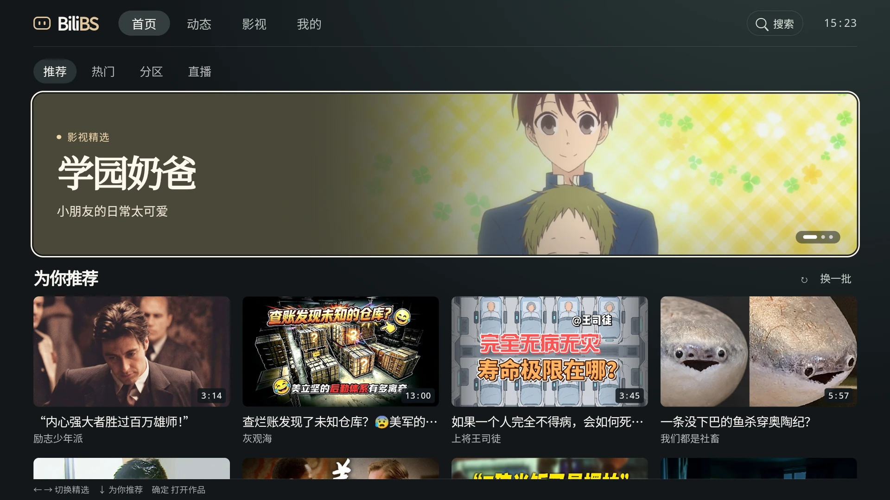
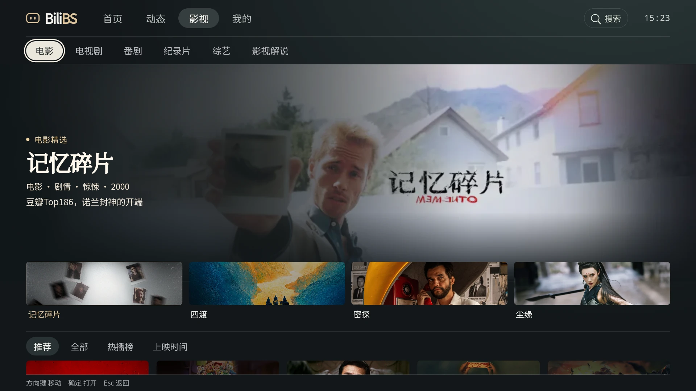
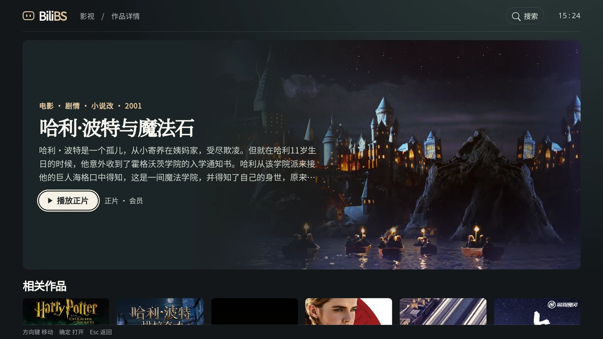
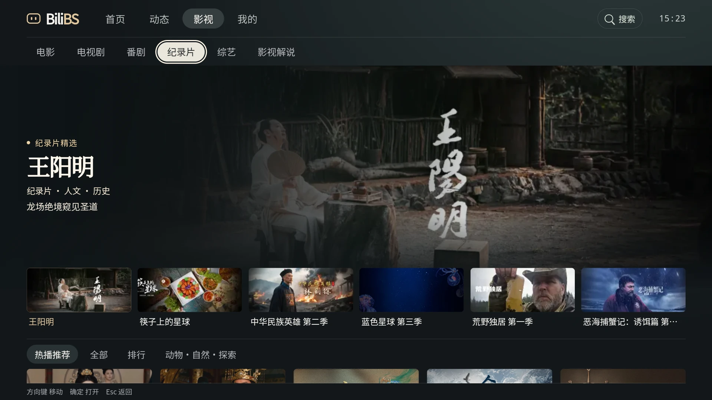
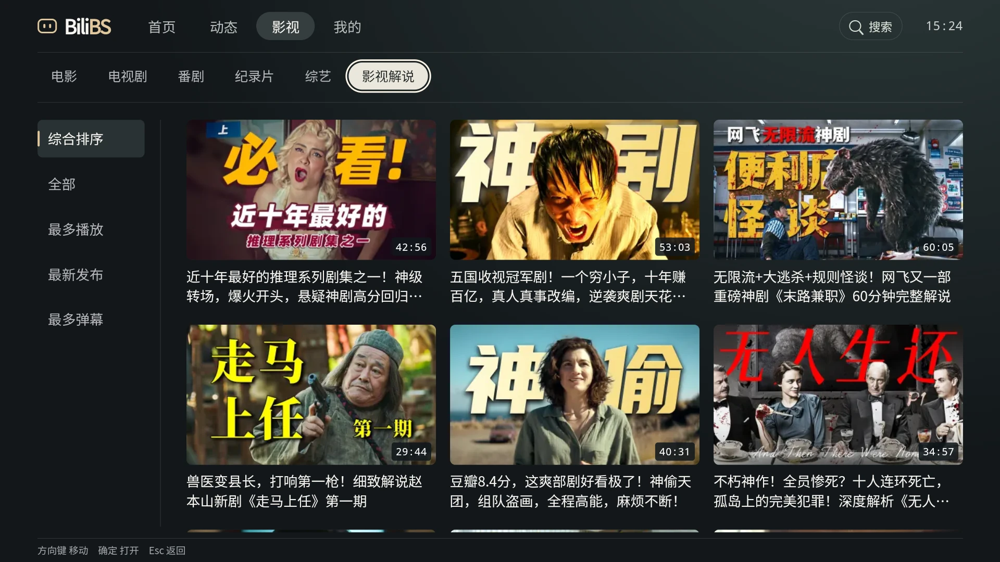
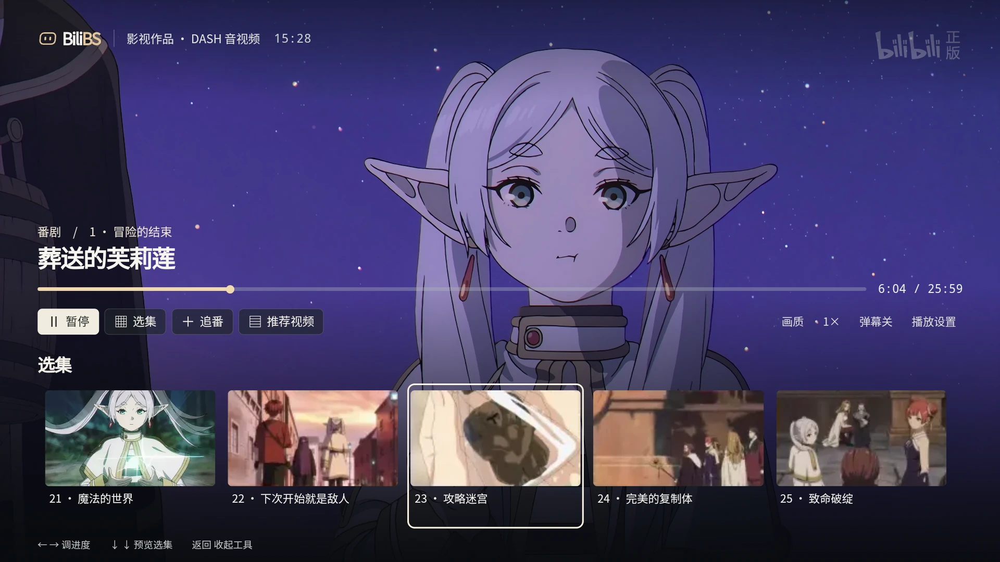

# BiliBS · Bili Big Screen

**在客厅的大屏幕上，舒服地看 B 站。**

BiliBS 是面向 Android TV 和电视盒子的第三方哔哩哔哩客户端。用遥控器发现视频、追番看剧，也能从上次停下的地方继续观看。

## 为遥控器和大屏幕而做

- **发现想看的内容**：视频推荐、热门与每周必看、分区、动态和直播。
- **在客厅挑一部好作品**：电影、电视剧、番剧、纪录片与综艺，配合沉浸海报、作品详情和图片选集。
- **接着看，也方便找**：扫码登录、追看片单、收藏、观看历史，以及适合遥控器操作的搜索。

## 界面预览

以下为当前版本在 Android TV 模拟器中的实际截图，展示内容会随平台更新。

| 影视频道 | 作品详情 |
| :---: | :---: |
|  |  |
| **纪录片** | **影视解说** |
|  |  |

**播放与选集**

## 开始使用

适用于 Android TV 8.0 及以上设备，需要可用的 Android System WebView。

方向键移动，确定键打开，返回键逐层退出。播放时先按返回收起工具，再按一次返回退出播放。

[安装与构建说明](android/README.md) · [问题反馈与建议](https://github.com/HAHAHAMMER/BiliBS/issues)

开发与本地体验

在项目根目录运行 `python tools/dev_server.py --port 8765`，然后打开 <http://127.0.0.1:8765/>，可在浏览器中体验界面。键盘方向键、Enter 和 Esc 对应遥控器操作。

Windows 可运行 `powershell -NoProfile -ExecutionPolicy Bypass -File tools/start_emulator.ps1`，自动构建、校验并在 Android TV 模拟器中打开当前版本。需要 Python、JDK、Android SDK 和已创建的电视模拟器；可用 `-Python`、`-Sdk`、`-Avd` 指定本机环境。

## 声明

BiliBS 是独立第三方项目，与哔哩哔哩及其关联公司无隶属、合作或背书关系。

仅供个人学习、研究与非商业使用。禁止销售、付费分发、广告变现、商业预装及其他商业用途。第三方组件遵循各自许可证。

视频、图片、音频、文字及商标等权利归相应权利人所有，内容访问以平台授权、账号权限和所在地区为准。权利人如有异议，可通过 [Issues](https://github.com/HAHAHAMMER/BiliBS/issues) 联系维护者。
